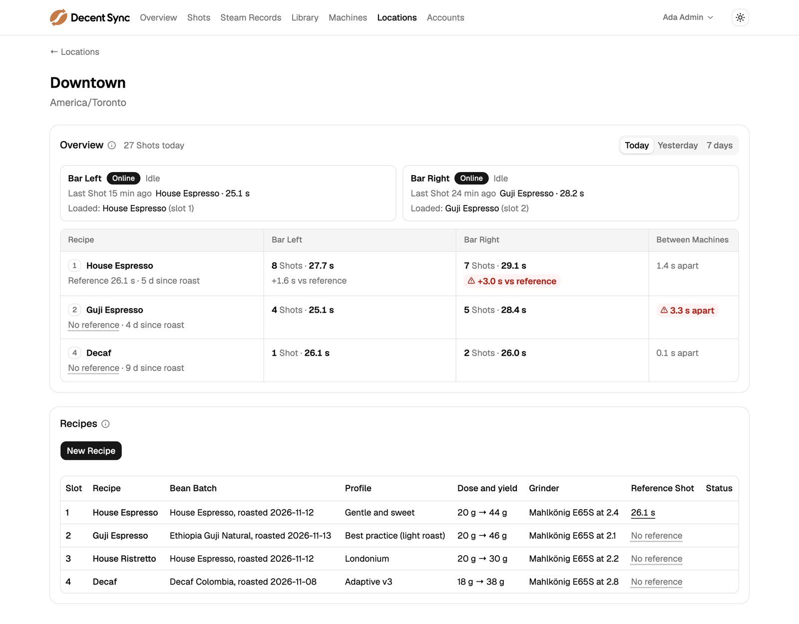
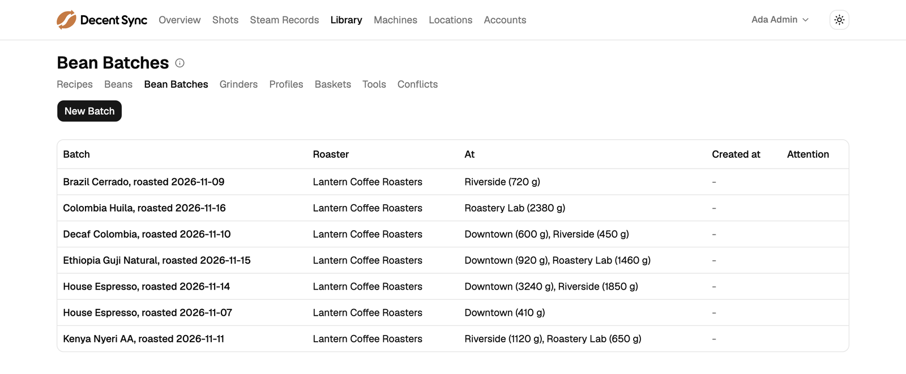
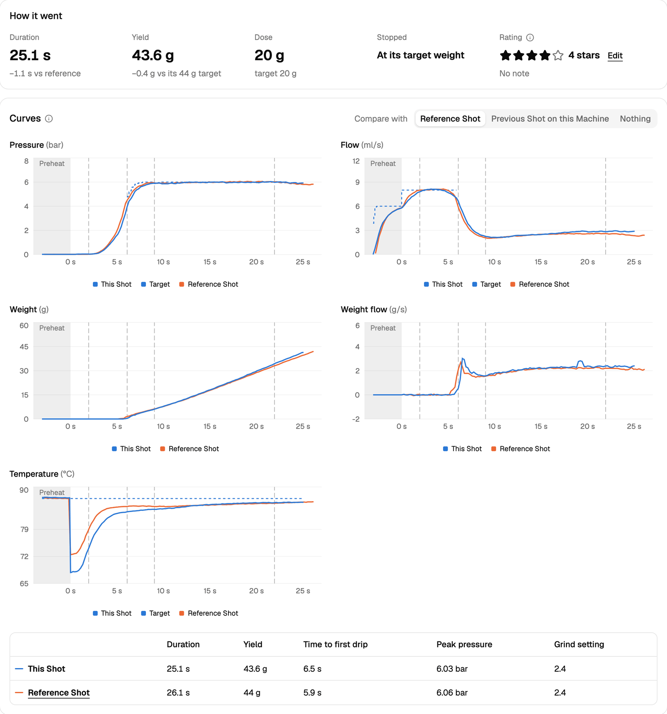
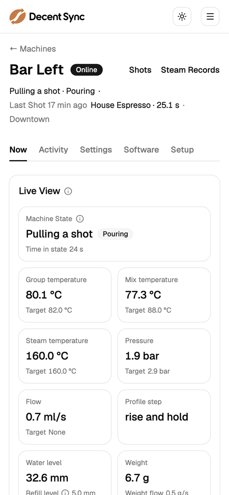

<h1>
  <picture>
    <source media="(prefers-color-scheme: dark)" srcset="web/src/assets/decent-sync-logo-dark.svg">
    
  </picture>
</h1>

**Your Decent espresso machines, working as one.**

Decent Sync connects every Decent espresso machine you run, at home or across
several cafes, to one server you host yourself. Enter a bag of beans once and
every machine has it. Dial in on one machine, and the others with that recipe
follow. Every shot from every machine lands in one place, linked to the beans,
grinder and profile that made it. And you can watch, adjust and ask about any
machine from your phone.

It works with any DE1 model or a Bengle running
[Decaid](https://github.com/decentespresso/decaid). It is free and open
source, and because you host it, your data stays yours. It runs in
production at its author's cafe.

<p align="center">
  <picture>
    <source media="(prefers-color-scheme: dark)" srcset="docs/images/live-view-dark.gif">
    
  </picture>
  <br>
  <sub>A shot on a Machine's Live View, shown at twice its speed. Screenshots use sample data, but every curve is a real recorded shot.</sub>
</p>

## Why Decent Sync

A Decent tablet keeps everything to itself: its shots, its beans, its
profiles and its settings. With two machines, you enter every bag of beans
twice, dial in twice, and compare shots by walking between tablets. With
several cafes, nobody can see across them at all.

Decent Sync makes them one system. Baristas keep using Decaid, DYE2 and
Streamline exactly as before. The plugin keeps the tablets in step and sends
everything they record to your server.

## Who it's for

Each server has one owner: a household, or a business with all of its sites.

- **A home with two machines.** One bean shelf, shared. A bag entered on
  either tablet appears on both, with one remaining weight, and every shot
  from both machines is in one history.
- **A cafe.** Several DE1s work like the groups of one commercial machine: the
  same Recipes on the same buttons, one remaining weight for each batch, and a
  dial-in change on one group reaching every group with that Recipe loaded.
- **A roastery with cafes.** Develop Profiles and Recipes in the lab, then roll
  them out: show a Profile at a cafe, or copy a Recipe there. Trace every shot
  at every site back to the roast batch it used. Give each person the access
  they need: Admin, Staff at their own cafe, or a Viewer who only looks.

## Features

### A shared Library and Recipes

- **Enter it once.** Beans, Bean Batches, Grinders and Profiles entered on any
  tablet join one Library, and reach the other tablets at that Location. Add
  and edit beans, batches and grinders from the web too, and a Profile's
  title, author and notes.
- **Each Location chooses what it offers.** A batch is at the Locations it was
  added to, with its own remaining weight at each. Profiles, Baskets and Tools
  are shown or hidden per Location. Grinders belong to their Location.
- **Recipes that follow the dial-in.** The Machines at a Location share its
  DYE2 recipes and nine Recipe Slots, of which Streamline's strip shows 1 to
  5, and use the Baskets and Tools it shows.
  A change made on a
  Machine is saved into the Recipe it has loaded. An edit to a Recipe, from a
  tablet or the web, reaches every Machine with it loaded. A Recipe is the
  whole Shot: a Machine that loads it is left with none of what it names
  none of, such as a Grinder or Basket. Each Recipe holds
  its steam, hot water and flush settings too, and a Machine keeps its own
  for those it holds none of. Loading a Recipe turns the Machine's steam on
  at its steam temperature, or off where it holds "Off".
- **A Reference Shot for each Recipe.** Make the Shot you just dialled in,
  or one from another Location, such as the lab's, the Shot a Recipe's
  Shots should go like. Its page shows the Shot's pressure, flow and weight
  curves in small, with its duration, yield against target, rating and grind
  setting, says where its Profile is another than the Recipe's, and keeps who
  chose it, or the Machine it was chosen on, in its history. It stays until someone chooses
  another or clears it, and the Shots list marks it. Each tablet at the
  Recipe's Location keeps a copy for a Skin to draw, while the Recipe is in
  a Recipe Slot, and a Skin may choose it there. The Recipe's other
  Shots are read against it in four places: a Shot's page draws its curves
  behind the Shot's own, the Overview says how far each Machine's median
  duration is from its own, the Recipe's page does the same beside each
  Machine's numbers and draws its duration across the trend, and a summary
  grouped by Recipe, through the REST API or an assistant, gives its numbers
  beside the Recipe's. A Shot's duration, and a group's median, more than
  10% from its own is out of spec (below).
- **A Profile you can read.** A Profile's page draws how it runs: a
  simulation on a standard puck, finer or coarser, as a DE1 or a Bengle,
  with pressure, flow and temperature each in a lane, the plan dashed behind
  the run, each step a band saying how long it ran and why it ended, its
  exits and limits drawn where they act, and the first drip and each 10 g
  marked. Lay any Shot over it, and the simulation takes that Shot's dose,
  the weight it stopped at, its Machine and the grind that best imitates it, so a finer or coarser grind shows how that Shot would likely shift. Its steps are listed in plain
  words, with what a Recipe replaces. Its versions, each Profile saved from
  the one before, are listed with who saved each, and any two compared, each
  simulated on the same puck. It lists the Recipes on it, with the Machines
  that have each loaded, and exports as Decaid's profile JSON.
- **Shape a Profile on its graph.** Edit a Profile, duplicate any, Decaid's
  bundled ones included, or start one from six starting shapes or a profile
  file, as a Draft kept here and on no tablet, saved as it changes. Drag a
  step's target, exit and maximum time on the graph, or use the keyboard and
  the inspector beside it; add, duplicate, delete and reorder steps; undo
  and redo. The graph simulates again on every change, with the version it
  started from faint behind it, and checks list what would stop it
  publishing and what the machine accepts that may not be meant, such as a
  target the run never reaches. Publish a Draft as a new version, in the old
  one's place at the Locations you choose with the Recipes you choose, or as
  a separate Profile, or return to an earlier version the same way.
- **Try a Draft on a Machine before publishing it.** At a Location an Admin
  marks for it, such as a lab, a Machine follows a Draft: the Draft's steps
  become what the Machine does next, and again on each save, without the
  Draft joining any tablet's Profiles. A Shot pulled on them is a Trial Shot,
  laid over the Draft's graph as it arrives, with the simulation set to match
  it, so what was simulated and what happened sit side by side.
- **No edit lost to a clash.** Edits merge field by field, and the edit made
  most recently wins. Every item keeps its history. An edit that lost to one made without
  seeing it is kept in the item's history as a Lost Edit, for you to read.
- **Safe deletes.** Deleting on a tablet only takes an item away at that
  Location. Sync never deletes anything from a tablet unless an Admin deletes
  it for good, which is possible only while no Shot names it.

<picture>
  <source media="(prefers-color-scheme: dark)" srcset="docs/images/location-dark.png">
  
</picture>

<picture>
  <source media="(prefers-color-scheme: dark)" srcset="docs/images/profile-dark.png">
  
</picture>

<picture>
  <source media="(prefers-color-scheme: dark)" srcset="docs/images/bean-batches-dark.png">
  
</picture>

### Every shot, traceable

- **Everything, from every Machine.** Shots and Steam Records with their
  curves, plus Workflow changes, machine state, settings and paired devices.
- **History included.** When the plugin first connects, the server collects
  every Shot and Steam Record already on the tablet, newest first.
- **Credited correctly.** Each Shot is credited by the hardware it recorded,
  so it goes to the Machine that pulled it even if the tablet has since moved
  to another machine, and to the Location that Machine was at. A Shot from
  hardware no Machine has yet waits under a Pending Machine for an Admin.
- **Linked to what made it.** Each Shot names its Bean Batch, Grinder,
  Profile, Recipe and Basket. Filter Shots by those, and by Location, Machine
  and date. Each item's page counts its Shots, and opens them in the Shots
  list. A Barista whose name was typed
  "jules" and "Jules" is one choice in the Barista filter, which finds both.
- **A list that leads with the Shots.** The Shots list keeps its date
  presets in view: Today, Yesterday, 7 days and 30 days, each Location's own
  days, and Custom for any dates. Its other filters open from one Filters
  button, in a sheet on a phone, and each one set is a chip above the list
  that names it and removes it. Filter by rating too: rated, not rated, or
  a least number of stars. Its Shots are under a heading for each day, and
  each row gives its Recipe, grind setting and dose, its yield with its
  difference from its own target, its duration with its difference from its
  Recipe's Reference Shot's, how it stopped where that was not at its
  target, and its rating in stars, with what is out of spec marked. On a
  phone each Shot is two lines, and nothing scrolls sideways. The Steam
  Records list has the same presets, button and chips.
- **Rated away from its tablet.** A Shot's rating, up to five stars as
  DYE2 shows it, and its note can be edited on its page, or by an
  assistant, by an Admin, or by Staff for Shots at the Locations they
  work at, and by a Skin on any tablet at the Shot's Location. The Shot
  shows the edit at once, and the
  plugin writes it into the Shot on the tablet that holds it, now or when
  that tablet next connects, so its Skin and DYE2 show the same. Until
  then the Shot's page says the edit awaits its tablet, or that it has no
  tablet to reach where that tablet no longer holds the Shot. Where the
  rating or the note was changed on that tablet later than the edit, the
  tablet's stands, and the edit is kept, marked as dropped. A card on the
  page lists each edit, with who made it and any Connected App it was made
  through, or the Machine whose tablet it was made on.
- **Summed up as you filter.** Above the Shots list, a summary of the Shots
  its filters find: how many there are, their median duration and yield
  against target, each with the range the middle half of them fall in, and
  the share that stopped at target, each marked where it is out of spec,
  the duration against the Reference Shot of the one Recipe the filters
  name. Choose others to show too: the ratio,
  peak pressure and flow, rating (in stars, such as "4 stars (3.5–4.5)"),
  grind setting, TDS, extraction yield, time to first drip, and the profile
  steps Shots ended in. Cleaning and
  calibration Shots are left out, and counted, as are Unfinished Shots, in
  which nothing poured: the Machine never reached pouring and the scale
  never showed a gram in the cup, as when a Shot is stopped at once.
- **Trends.** Under that summary, closed until opened, a chart of one of its
  numbers by day or by
  week, to see a coffee drift or a change take effect: each day's or week's
  median as a line, with a band for the range the middle half of its Shots
  fall in, or, for the share that stopped at target, a line alone. A rating
  is charted in stars, from 0 to 5. Filtered to one Recipe, it draws a line
  for each Machine that pulled it, and, charting duration, the Recipe's
  Reference Shot's as a dashed line. A day is
  each Shot's Location's own, in its time zone, or UTC's for a Shot with no
  Location, and a week starts on Monday. Whether it is open, the number and
  the day or week chosen are kept in the page's address, with the filters.
- **What is out of spec, marked.** The server judges a Machine's Shots of a
  Recipe over a period, and each Shot, against three margins: a duration
  more than 10% from the Recipe's Reference Shot's, a yield more than 5%
  from the Shot's own target, and, of a group, under 90% of its Shots
  stopped at target, which is Decaid stopping the Shot at its target weight
  or, with no scale, its target volume. A Recipe is out of spec between
  Machines where its fastest and slowest Machines' median durations are
  more than 10% of the slower one's apart. A group is judged on its medians
  and needs at least 3 Shots; fewer are not judged. A Shot Summary gives
  each group's judgement, and a Shot's read its own, through the REST API
  and an assistant, and the Overview marks them: a triangle and bold text
  beside the colour.
- **Each Location at a glance.** The home page is the Overview, the first
  item of the navigation: a block for each Location, headed by how many
  Shots the period's numbers cover. A status card for each Machine there
  says whether it is online and what it is doing, how long ago its last
  Shot was pulled, with its Recipe and duration and a mark for what of it
  is out of spec, and its Loaded Recipe with its Recipe Slot. A Machine
  that went offline is marked, unless it went offline asleep, as one left
  for the night. Under them, a row for each Recipe pulled today, yesterday
  or in the last 7 days, in Recipe Slot order, with its Reference Shot's
  duration, and a column for each Machine: a cell counts that Machine's
  Shots of that Recipe with their median duration, says how far that is
  from the reference, marked when out of spec, and gives their yield
  against target and how many stopped at target only when those are out of
  spec, with how many were unfinished, and opens them in the Shots list. A
  last column says how far apart the Recipe's Machines are. On a phone the
  cards stack and the cells shorten, so two Machines fit the screen, and
  with more the Recipe column stays in place while the cells scroll. Each
  Location's page shows its own block, with the period chosen in its
  heading.
- **Each Recipe on its page.** A Recipe's page shows how it is pulling
  before how it is set up. First its Reference Shot beside its numbers by
  Machine, for today, yesterday or the last 7 days, by its Location's days:
  for each Machine that pulled it, the count of Shots, their median duration
  with the range the middle half fall in and how far it is from the
  Reference Shot's, their yield against target and the share stopped at
  target, each marked where out of spec, and a last row for how far apart
  the Machines are, so the Machine that is off stands out. Then the last 30
  days by day, a line for each Machine with its middle-half band, of its
  duration, with the Reference Shot's as a dashed line, its yield against
  target or its grind setting, one at a time, so a coffee ageing or a
  grinder drifting shows. A grind setting is charted where it is a number,
  so a Recipe whose setting is text has no grind trend. Under them are the
  fields the Recipe has set, the rest shown on asking, how many Shots it
  has in the period, and its history, closed until opened. A Machine's
  count, and its name under the chart, open those Shots in the Shots list.
  Edit stays in view, with moving it to a slot, copying, Archiving and
  deleting in a menu beside it. On a phone the cards stack, and each
  Machine's numbers are a block of a few lines.
- **Every Recipe in the Library.** The Library opens on its Recipes: a
  table for each Location, in Recipe Slot order with those in no slot
  after, each with its Bean Batch, Profile, dose and yield, Grinder and
  setting, and its Reference Shot's duration, which opens that Shot, or "No
  reference", which opens its rated Shots to choose one from. Archived
  Recipes show on asking. A Location's page lists its own the same way.
- **Compared at a glance.** A Shot's page opens with how it went, its
  duration and yield marked where out of spec, and its curves over its
  Recipe's Reference Shot's, or the previous Shot's on its Machine.
  Everything else it recorded is under them, once, closed until opened.
  Steam Records show the milk's temperature.

<picture>
  <source media="(prefers-color-scheme: dark)" srcset="docs/images/overview-dark.png">
  
</picture>

<picture>
  <source media="(prefers-color-scheme: dark)" srcset="docs/images/shot-dark.png">
  
</picture>

### Machines, from anywhere

- **A page in five tabs.** Each Machine's page opens on Now, with Activity,
  Settings, Software and Setup beside it, and a link opens on the tab it
  names. Above
  the tabs, whichever is open: the Machine's name and whether it is online,
  what it is doing, its last Shot, marked where it was out of spec, its
  Location, links to its Shots and Steam Records, and anything that needs
  attention, such as a refused connection.
- **Now.** Its Live View: what the Machine is doing and measuring, and the
  curves of a shot or steaming as it runs. The Workflow it is set up to pull
  next, with the Recipe it was loaded from. And how its Shots are landing,
  Recipe by Recipe, today, yesterday or over 7 days: how many, their median
  duration against the Recipe's Reference Shot's, their yield against target
  and the share stopped at target, marked where out of spec.
- **Use, by day and by hour.** Its Activity tab charts how many Shots,
  Steam Records, flushes and hot water pours it made each day, for the last
  14 days or any range of up to 31, or each hour of one day, with how long it
  spent in each Machine State: idle, asleep, needing water and the rest. A
  day is its Location's own. For now, a Machine whose tablet was off counts
  as in its last state until the tablet is back.
- **What happened, day by day.** Under its use, the Activity tab lists a
  chosen day's activity, today's unless you choose another, as by choosing
  that day's bar in the chart: its dial-in trail, each
  Recipe loaded or unloaded and what was changed between them, from what to
  what and by whom, with links to the Recipe, Profile, Bean Batch, Grinder
  and Basket named; the Recipes it had loaded; and its Machine States.
- **Remote settings.** While a Machine's tablet is connected, edit the
  Machine's settings, wake schedules included, and the tablet's Decaid
  settings, on its Settings tab.
- **Settings History.** The Settings tab lists every change of the Machine's
  settings, plugins and their settings, Skins, paired devices and sensors,
  whatever made it, naming who made a Settings Edit's or a Software Action's
  and what came of it. A Settings Edit that changed nothing, as one refused
  or not confirmed, is listed too, and the list narrows to Settings Edits
  alone.
- **Its tablet's software.** The Software tab shows Decaid, with the update
  it offers and whether its automatic update checks are on, and every plugin
  and Skin on the tablet, each with its version and how it updates: Pinned,
  following releases or a branch, or not updated. While the tablet is
  connected and the Machine idle, an Admin installs a plugin from a
  repository's latest release, a branch or a commit, enables, disables,
  configures and removes one, checks the plugins for updates and approves
  one that waits on new permissions, asks Decaid to check for its own update,
  and turns the automatic update checks on or off. Each action is made once,
  never kept for later, and logged with who asked and what came of it. Staff
  and Viewers read the tab. Skins are shown, not yet managed.
- **Setup.** Its Setup tab holds what is looked at seldom: its hardware,
  firmware and tablets, with a link to the Software tab for what the tablet
  runs, its Location and where it has been, whether it shares the Library,
  and its token.
- **All the Machines at a glance.** The Machines list gives each Machine's
  Location, whether it is online, what it is doing, its last Shot, marked
  where it was out of spec, and its Loaded Recipe.
- **On your phone.** The management interface fits a phone's screen, in light
  or dark.

<p align="center">
  <picture>
    <source media="(prefers-color-scheme: dark)" srcset="docs/images/phone-dark.png">
    
  </picture>
</p>

### Ask about your coffee

Connect Claude, ChatGPT or another MCP app, and ask in plain words:

- "How many shots did the cafe pull yesterday, and with which beans?"
- "Have shots of the new Kenya batch been running faster than last week's?"
- "What is each machine at the cafe doing right now?"
- "How was the left machine dialed in this morning, and how did its shots run?"
- "Add this week's roast of the house blend at the cafe."
- "Put the new espresso recipe in slot 2."

The assistant acts as you, within what your account may do. Each Library
change and Settings Edit it makes is recorded as made through it. See
[Connecting an assistant](#connecting-an-assistant).

### Runs on your terms

- **Self-hosted.** One Docker image and PostgreSQL. Run it on a spare computer
  on your network, or on the internet for several sites.
- **Machines don't depend on it.** If the network or server goes down, the
  machines keep working on their own, and the plugin catches up when the
  server is back.
- **No downtime.** Run two or more server instances behind a proxy that routes
  by their health check, and upgrades take nothing offline.
- **Free and open source**, under the MIT license.

## How it works

```
Tablets (Decaid + plugin) ── WebSocket ──┐
Management interface ─────── REST API ───┼──▶  Server  ──▶  PostgreSQL
AI assistants ────────────── MCP ────────┘
```

The plugin runs inside Decaid on each machine's tablet. It sends the server
everything the tablet records, and writes the shared Library and Recipes back
to it. The server can run as several instances on one database.

| What | Shared with |
|---|---|
| Beans, Bean Batches, Profiles, Baskets and Tools | Every Location. Each Location offers its own part: the Profiles, Baskets and Tools shown there, the batches there with their Beans, and its own stock of each batch. |
| Grinders, Recipes and Recipe Slots | The Machines at one Location. |
| What a Machine is using: its profile, dose, yield, batch, grinder, basket, and steam, hot water and flush settings | Nothing. Each Machine has its own, which loading a Recipe sets, steam turned on or off as the Recipe holds it. Turning steam off at the Machine never changes the Recipe. |

A few rules shape the rest:

- **A Machine is its hardware**, identified by model and serial number.
  Replacing its tablet doesn't make it a new Machine.
- **Machines are adopted by hand.** An Admin adds each Machine in the
  management interface, which issues a token for its plugin.
- **The server is the source of truth, but tablets can still edit.** A tablet
  holds only what its Location offers. What a tablet creates starts at its
  Location only.

[GLOSSARY.md](GLOSSARY.md) defines the terms. [docs/adr/](docs/adr/) records
the design decisions and why they were made.

## Quick start

You need Docker on a computer your machines' tablets can reach. Give it a
fixed address on your network, such as with a DHCP reservation in your router.

1. Download the Compose file, set the address people and tablets will use,
   and start the server and PostgreSQL:

   ```bash
   curl -O https://raw.githubusercontent.com/loganfuller/decent-sync/main/docker-compose.yml
   echo 'PUBLIC_URL=http://192.168.1.20:3000' > .env
   docker compose up -d
   ```

2. Open `PUBLIC_URL` in a browser and create the first Admin account. Do this
   straight away: until you do, anyone who can reach the server can.
3. Under **Locations**, add one for each site. A Machine shares the Library
   and Recipes only while it is at a Location.
4. Under **Machines**, add each machine at its Location. Copy the server URL
   and token it shows. The token is shown only once.
5. [Install the plugin](#installing-the-plugin) on each machine's tablet, and
   enter the server URL and token.

To invite other people, go to **Accounts**.

Over plain `http://`, traffic is unencrypted, each Machine's token included.
Use it only on a network you trust.
[docs/SELF-HOSTING.md](docs/SELF-HOSTING.md) covers every setting, running on
the internet, fly.io, and upgrading.

> [!IMPORTANT]
> Tablets install each new plugin release within 12 hours, unless it asks for
> a new permission, and a plugin two releases ahead of its server may not work
> with it. Upgrade the server soon
> after each release: `docker compose pull && docker compose up -d`.

## Installing the plugin

The plugin needs Decaid v0.9.3 or newer. For a Machine to follow Recipes, its
tablet also needs DYE2 v0.1.42 or newer, and Streamline v0.2.31 or newer if
Streamline is its skin.

1. On the tablet, open Decaid's **Settings**, then **Plugins**.
2. Choose **Install Plugin**, then **GitHub Release**, and enter
   `loganfuller/decent-sync` as the repository.
3. In the plugin's settings, enter the **Server URL** (your `PUBLIC_URL`) and
   the Machine's **Token**.

The Machine then shows as online in the management interface. While the
plugin has stopped syncing, such as when the server refuses its token or has
been out of reach for 10 minutes, the tablet says why in a notice under
Decaid's bell. Decaid keeps the plugin up to date. An update that asks for a new permission waits until
someone approves it: at the tablet, or, once its plugin takes Software
Actions, an Admin on the Machine's Software tab.

[docs/PLUGIN.md](docs/PLUGIN.md) covers installing from a computer, updates and
approvals, the plugin's settings, and what it does on the tablet.

## Connecting an assistant

Each person can connect their own AI assistant. Add the server's MCP endpoint:
your `PUBLIC_URL` followed by `/api/mcp`, such as
`https://sync.example.com/api/mcp`.

| App | How |
|---|---|
| Claude, on the web, desktop or phone | Add it as a custom connector |
| ChatGPT | Add it as a custom MCP server, with Client Identifier Metadata Document (CIMD) as its registration method and the Registration URL, client ID and secret left blank |
| Claude Code | `claude mcp add --transport http decent-sync https://sync.example.com/api/mcp` |
| VS Code | Add it as an HTTP MCP server |

The app sends you to the server to sign in and approve it, either to read only
or to read and change. It then acts as you, within what your account may do. A
Viewer's app can only read.

An assistant can read Locations, Machines with their settings, then or now,
their activity, each dial-in change included, and how much each was used by
day or by hour, each Machine's scale,
sensors, paired devices, plugins and Skins, Settings Edits and Settings
History, Shots with their curves, the profile steps they ran, their time to
first drip and their flow at the stop, or every sample of a Shot,
unrounded, for closer analysis, found by any of the Shots list's
filters, its rating filter and its periods of each Location's own days
among them, a summary of the Shots any filter
finds, with the numbers it asks for, as one group or grouped by Machine,
Recipe, Bean, Bean Batch, Profile, Grinder, Basket, Barista or Location,
two at once, such as two Machines on the same Recipe side by side, and by
day or by week, each Location's own, to read a trend, Steam
Records, and the Library
with each item's history, Lost Edits among it, and simulate a Profile on a standard
puck, finer or coarser, or on a Shot's, for a DE1 or a Bengle, saying how
close its simulation of that Shot's own steps comes to the Shot, and read a
Profile's versions and the Recipes on it. It can create
and edit Beans, Bean Batches, Grinders, Baskets, Tools and Recipes, edit a
Profile's title, author and notes, Archive and
restore Library items, change what a Location offers, put Recipes in Recipe
Slots, choose their Reference Shots and copy them to other Locations, make
Settings Edits, move Machines between Locations, and rate a Shot or edit its
note, saying whether that edit still awaits the Shot's tablet. An Admin's assistant can
also turn a Machine's sharing on or off, and create and edit Locations. Nothing
an assistant does grants access or deletes anything for good. Each Library
change, Settings Edit and edit of a Shot it makes is recorded as "*account*,
through *app*".

Each answer is kept small enough for Claude and ChatGPT to read whole: a long
list comes a page at a time, and very long text, such as a Shot's notes, may be
cut, saying so and how to read more of it. Codex, Gemini CLI and VS Code take
less, and may cut the larger answers or save them to a file.

To see or disconnect your apps, open **Connected Apps** in the account menu.

Claude and ChatGPT connect from their own clouds, so for them the server must
be on the internet at an `https://` address. See
[docs/SELF-HOSTING.md](docs/SELF-HOSTING.md#assistants) for the details, and
for how to turn assistants off.

## Status

What each release added. See [all releases](https://github.com/loganfuller/decent-sync/releases).

| Released | What it added | Spec |
|---|---|---|
| [v1.0.0](https://github.com/loganfuller/decent-sync/releases/tag/v1.0.0) | Adopting Machines, Locations and accounts. Captures Shots, Steam Records, Workflow changes, machine state, the library, settings and paired devices. | [#1](https://github.com/loganfuller/decent-sync/issues/1) |
| [v1.0.0](https://github.com/loganfuller/decent-sync/releases/tag/v1.0.0) | Beans, Bean Batches, Grinders and Profiles shared across Locations, with history and Lost Edits (Conflicts, until #632). Shots linked to what they used. | [#77](https://github.com/loganfuller/decent-sync/issues/77) |
| [v1.0.0](https://github.com/loganfuller/decent-sync/releases/tag/v1.0.0) | DYE2 Recipes, Baskets and Tools, Recipe Slots, and each Machine's Loaded Recipe. | [#134](https://github.com/loganfuller/decent-sync/issues/134) |
| [v1.2.0](https://github.com/loganfuller/decent-sync/releases/tag/v1.2.0), [v1.5.0](https://github.com/loganfuller/decent-sync/releases/tag/v1.5.0) | Settings Edits from the management interface, then each Machine's Live View. No remote commands such as sleep and wake. | [#220](https://github.com/loganfuller/decent-sync/issues/220), [#258](https://github.com/loganfuller/decent-sync/issues/258) |
| [v1.4.0](https://github.com/loganfuller/decent-sync/releases/tag/v1.4.0) | Each release runs beside the previous one. | [#277](https://github.com/loganfuller/decent-sync/issues/277) |
| [v1.7.0](https://github.com/loganfuller/decent-sync/releases/tag/v1.7.0), [v1.8.0](https://github.com/loganfuller/decent-sync/releases/tag/v1.8.0) | AI assistants through an MCP endpoint, each approved as a Connected App, then answers sized for them, with more of each Machine and Shot. | [#405](https://github.com/loganfuller/decent-sync/issues/405) |
| [v1.9.0](https://github.com/loganfuller/decent-sync/releases/tag/v1.9.0) | Shot Summaries by Recipe, Machine, Barista and more, with trends; an Overview of each Location; a Reference Shot for each Recipe; and each Machine's activity. | [#465](https://github.com/loganfuller/decent-sync/issues/465) |
| [v1.10.0](https://github.com/loganfuller/decent-sync/releases/tag/v1.10.0) | A Location's Shots and each Recipe's Reference Shot on its tablets, for any Skin to show; a Reference Shot chosen on a tablet; a Shot's rating and note edited from another tablet, the management interface or an assistant; and nine Recipe Slots. | [#503](https://github.com/loganfuller/decent-sync/issues/503) |
| [v1.12.0](https://github.com/loganfuller/decent-sync/releases/tag/v1.12.0) | Each Profile read on a graph of how it runs, simulated on a standard puck with any Shot laid over it; Drafts written on the graph, published as a new Profile Version or a separate Profile, and tried on a Machine at a Location marked for it, its Shots Trial Shots; and each Profile held to what its Machines' models can run. | [#574](https://github.com/loganfuller/decent-sync/issues/574) |

In progress, in v1.13.0 ([#657](https://github.com/loganfuller/decent-sync/issues/657)): each Tablet's plugins, Skins and Decaid seen from the management interface, and its plugins managed there, on a Machine's Software tab, and a notice on the Tablet saying why its plugin stopped syncing. Still to come in it: its Skins managed and reloaded.

Planned after that, in no fixed order:

- **Monitoring**: noticing lost Shots, low water and dropped scale or Machine connections, with alerts.
- **Calibration**: checks of stop-at-weight, flow and temperature.
- **Stock**: deliveries, transfers, counts, and the coffee each Shot uses.

## Documentation

| Guide | What it covers |
|---|---|
| [docs/SELF-HOSTING.md](docs/SELF-HOSTING.md) | Configuration, accounts, local networks and the internet, reverse proxies, assistants, fly.io, upgrading |
| [docs/PLUGIN.md](docs/PLUGIN.md) | Installing, updating and configuring the tablet plugin, and what it does on the tablet |
| [UPGRADING.md](UPGRADING.md) | What each release needs beyond its new image |
| [GLOSSARY.md](GLOSSARY.md) | What each term means |
| [docs/adr/](docs/adr/) | Design decisions and why they were made |
| [docs/DEVELOPMENT.md](docs/DEVELOPMENT.md) | Repository layout, building, testing and releasing |

## Development

You need Node.js 26 or newer with Temporal, and Docker for PostgreSQL.
nodejs.org's builds include Temporal. Some packaged builds, such as Homebrew's,
don't.

```bash
npm install
cp .env.example .env
npm run db:up      # PostgreSQL in Docker
npm start          # build, migrate and serve http://localhost:3000
```

See [docs/DEVELOPMENT.md](docs/DEVELOPMENT.md) for the commands, tests and
release process.

## License

[MIT](LICENSE)
