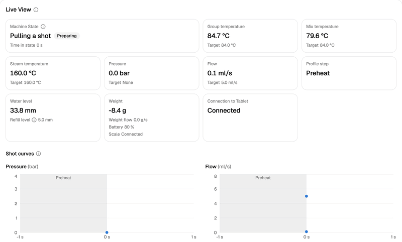
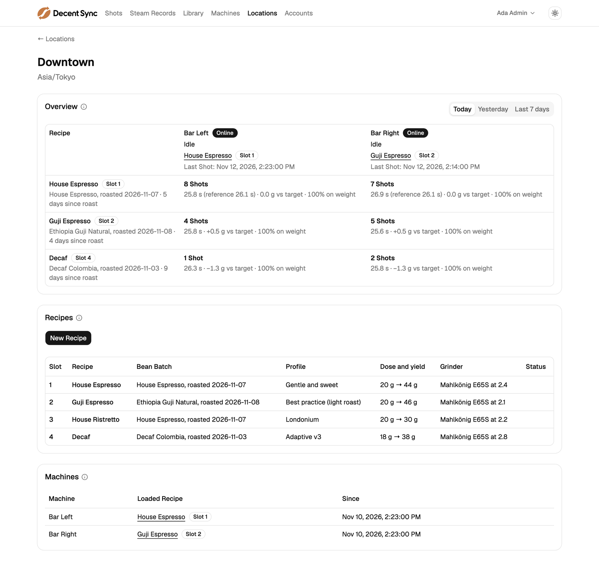
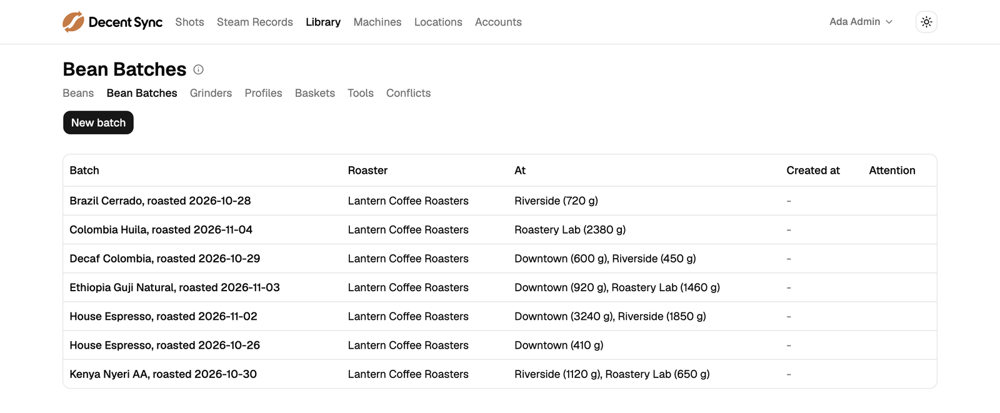
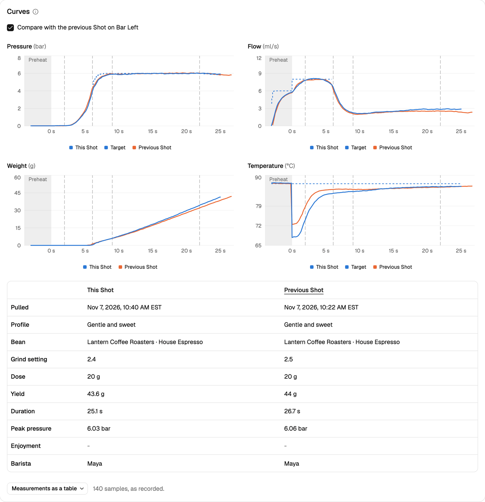
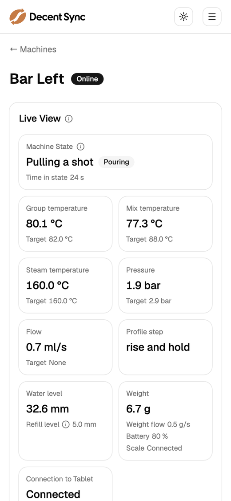

<h1>
  <picture>
    <source media="(prefers-color-scheme: dark)" srcset="web/src/assets/decent-sync-logo-dark.svg">
    
  </picture>
</h1>

**Your Decent espresso machines, working as one.**

Decent Sync connects every Decent espresso machine you run, at home or across
several cafes, to one server you host yourself. Enter a bag of beans once and
every machine has it. Dial in on one machine, and the others with that recipe
follow. Every shot from every machine lands in one place, linked to the beans,
grinder and profile that made it. And you can watch, adjust and ask about any
machine from your phone.

It works with any DE1 model or a Bengle running
[Decaid](https://github.com/decentespresso/decaid). It is free and open
source, and because you host it, your data stays yours. It runs in
production at its author's cafe.

<p align="center">
  <picture>
    <source media="(prefers-color-scheme: dark)" srcset="docs/images/live-view-dark.gif">
    
  </picture>
  <br>
  <sub>A shot on a Machine's Live View, shown at twice its speed. Screenshots use sample data, but every curve is a real recorded shot.</sub>
</p>

## Why Decent Sync

A Decent tablet keeps everything to itself: its shots, its beans, its
profiles and its settings. With two machines, you enter every bag of beans
twice, dial in twice, and compare shots by walking between tablets. With
several cafes, nobody can see across them at all.

Decent Sync makes them one system. Baristas keep using Decaid, DYE2 and
Streamline exactly as before. The plugin keeps the tablets in step and sends
everything they record to your server.

## Who it's for

Each server has one owner: a household, or a business with all of its sites.

- **A home with two machines.** One bean shelf, shared. A bag entered on
  either tablet appears on both, with one remaining weight, and every shot
  from both machines is in one history.
- **A cafe.** Several DE1s work like the groups of one commercial machine: the
  same Recipes on the same five buttons, one remaining weight for each batch, and a
  dial-in change on one group reaching every group with that Recipe loaded.
- **A roastery with cafes.** Develop Profiles and Recipes in the lab, then roll
  them out: show a Profile at a cafe, or copy a Recipe there. Trace every shot
  at every site back to the roast batch it used. Give each person the access
  they need: Admin, Staff at their own cafe, or a Viewer who only looks.

## Features

### A shared Library and Recipes

- **Enter it once.** Beans, Bean Batches, Grinders and Profiles entered on any
  tablet join one Library, and reach the other tablets at that Location. Add
  and edit beans, batches and grinders from the web too.
- **Each Location chooses what it offers.** A batch is at the Locations it was
  added to, with its own remaining weight at each. Profiles, Baskets and Tools
  are shown or hidden per Location. Grinders belong to their Location.
- **Recipes that follow the dial-in.** The Machines at a Location share its
  DYE2 recipes and five Recipe Slots, and use the Baskets and Tools it shows.
  A change made on a
  Machine is saved into the Recipe it has loaded. An edit to a Recipe, from a
  tablet or the web, reaches every Machine with it loaded. Each Recipe holds
  its steam, hot water and flush settings too.
- **No edit lost to a clash.** Edits merge field by field, and the edit made
  most recently wins. Every item keeps its history. An edit that lost to one made without
  seeing it is kept as a Conflict, for you to use or dismiss.
- **Safe deletes.** Deleting on a tablet only takes an item away at that
  Location. Sync never deletes anything from a tablet unless an Admin deletes
  it for good, which is possible only while no Shot names it.

<picture>
  <source media="(prefers-color-scheme: dark)" srcset="docs/images/location-dark.png">
  
</picture>

<picture>
  <source media="(prefers-color-scheme: dark)" srcset="docs/images/bean-batches-dark.png">
  
</picture>

### Every shot, traceable

- **Everything, from every Machine.** Shots and Steam Records with their
  curves, plus Workflow changes, machine state, settings and paired devices.
- **History included.** When the plugin first connects, the server collects
  every Shot and Steam Record already on the tablet, newest first.
- **Credited correctly.** Each Shot is credited by the hardware it recorded,
  so it goes to the Machine that pulled it even if the tablet has since moved
  to another machine, and to the Location that Machine was at. A Shot from
  hardware no Machine has yet waits under a Pending Machine for an Admin.
- **Linked to what made it.** Each Shot names its Bean Batch, Grinder,
  Profile, Recipe and Basket. Filter Shots by those, and by Location, Machine
  and date. Each item's page lists its Shots.
- **Summed up as you filter.** Above the Shots list, a summary of the Shots
  its filters find: how many there are, their median duration and yield
  against target, each with the range the middle half of them fall in, and
  the share that stopped on weight. Cleaning and calibration Shots are left
  out, and counted.
- **Compared at a glance.** Open any Shot's curves beside the previous Shot on
  its Machine. Steam Records show the milk's temperature.

<picture>
  <source media="(prefers-color-scheme: dark)" srcset="docs/images/shot-dark.png">
  
</picture>

### Machines, from anywhere

- **Live View.** Watch what a Machine is doing and measuring, and the curves of
  a shot or steaming as it runs.
- **Use, by day and by hour.** Each Machine's page charts how many Shots,
  Steam Records, flushes and hot water pours it made each day, for the last
  14 days or any range of up to 31, or each hour of one day, with how long it
  spent in each Machine State: idle, asleep, needing water and the rest. A
  day is its Location's own. For now, a Machine whose tablet was off counts
  as in its last state until the tablet is back.
- **What happened, day by day.** Each Machine's page lists a chosen day's
  activity, today's unless you choose another: its dial-in trail, each
  Recipe loaded or unloaded and what was changed between them, from what to
  what and by whom, with links to the Recipe, Profile, Bean Batch, Grinder
  and Basket named; the Recipes it had loaded; and its Machine States.
- **Remote settings.** While a Machine's tablet is connected, edit the
  Machine's settings, wake schedules included, and the tablet's Decaid
  settings. Each Settings Edit is listed with who made it and what came of it.
- **Settings History.** Each Machine's page lists every change of its settings,
  plugins, Skins, paired devices and sensors, whatever made it, naming who made
  a Settings Edit's.
- **The whole picture.** Each Machine's page shows what it is set up to pull
  next, its scale, sensors and calibration, and the plugin release it runs.
- **On your phone.** The management interface fits a phone's screen, in light
  or dark.

<p align="center">
  <picture>
    <source media="(prefers-color-scheme: dark)" srcset="docs/images/phone-dark.png">
    
  </picture>
</p>

### Ask about your coffee

Connect Claude, ChatGPT or another MCP app, and ask in plain words:

- "How many shots did the cafe pull yesterday, and with which beans?"
- "Have shots of the new Kenya batch been running faster than last week's?"
- "What is each machine at the cafe doing right now?"
- "How was the left machine dialed in this morning, and how did its shots run?"
- "Add this week's roast of the house blend at the cafe."
- "Put the new espresso recipe in slot 2."

The assistant acts as you, within what your account may do. Each Library
change and Settings Edit it makes is recorded as made through it. See
[Connecting an assistant](#connecting-an-assistant).

### Runs on your terms

- **Self-hosted.** One Docker image and PostgreSQL. Run it on a spare computer
  on your network, or on the internet for several sites.
- **Machines don't depend on it.** If the network or server goes down, the
  machines keep working on their own, and the plugin catches up when the
  server is back.
- **No downtime.** Run two or more server instances behind a proxy that routes
  by their health check, and upgrades take nothing offline.
- **Free and open source**, under the MIT license.

## How it works

```
Tablets (Decaid + plugin) ── WebSocket ──┐
Management interface ─────── REST API ───┼──▶  Server  ──▶  PostgreSQL
AI assistants ────────────── MCP ────────┘
```

The plugin runs inside Decaid on each machine's tablet. It sends the server
everything the tablet records, and writes the shared Library and Recipes back
to it. The server can run as several instances on one database.

| What | Shared with |
|---|---|
| Beans, Bean Batches, Profiles, Baskets and Tools | Every Location. Each Location offers its own part: the Profiles, Baskets and Tools shown there, the batches there with their Beans, and its own stock of each batch. |
| Grinders, Recipes and Recipe Slots | The Machines at one Location. |
| What a Machine is using: its profile, dose, yield, batch, grinder, basket, and steam, hot water and flush settings | Nothing. Each Machine has its own, which loading a Recipe sets. Turning steam off never changes the Recipe. |

A few rules shape the rest:

- **A Machine is its hardware**, identified by model and serial number.
  Replacing its tablet doesn't make it a new Machine.
- **Machines are adopted by hand.** An Admin adds each Machine in the
  management interface, which issues a token for its plugin.
- **The server is the source of truth, but tablets can still edit.** A tablet
  holds only what its Location offers. What a tablet creates starts at its
  Location only.

[GLOSSARY.md](GLOSSARY.md) defines the terms. [docs/adr/](docs/adr/) records
the design decisions and why they were made.

## Quick start

You need Docker on a computer your machines' tablets can reach. Give it a
fixed address on your network, such as with a DHCP reservation in your router.

1. Download the Compose file, set the address people and tablets will use,
   and start the server and PostgreSQL:

   ```bash
   curl -O https://raw.githubusercontent.com/loganfuller/decent-sync/main/docker-compose.yml
   echo 'PUBLIC_URL=http://192.168.1.20:3000' > .env
   docker compose up -d
   ```

2. Open `PUBLIC_URL` in a browser and create the first Admin account. Do this
   straight away: until you do, anyone who can reach the server can.
3. Under **Locations**, add one for each site. A Machine shares the Library
   and Recipes only while it is at a Location.
4. Under **Machines**, add each machine at its Location. Copy the server URL
   and token it shows. The token is shown only once.
5. [Install the plugin](#installing-the-plugin) on each machine's tablet, and
   enter the server URL and token.

To invite other people, go to **Accounts**.

Over plain `http://`, traffic is unencrypted, each Machine's token included.
Use it only on a network you trust.
[docs/SELF-HOSTING.md](docs/SELF-HOSTING.md) covers every setting, running on
the internet, fly.io, and upgrading.

> [!IMPORTANT]
> Tablets install each new plugin release within 12 hours, unless it asks for
> a new permission, and a plugin two releases ahead of its server may not work
> with it. Upgrade the server soon
> after each release: `docker compose pull && docker compose up -d`.

## Installing the plugin

The plugin needs Decaid v0.9.1 or newer. For a Machine to follow Recipes, its
tablet also needs DYE2 v0.1.36 or newer, and Streamline v0.2.24 or newer if
Streamline is its skin.

1. On the tablet, open Decaid's **Settings**, then **Plugins**.
2. Choose **Install Plugin**, then **GitHub Release**, and enter
   `loganfuller/decent-sync` as the repository.
3. In the plugin's settings, enter the **Server URL** (your `PUBLIC_URL`) and
   the Machine's **Token**.

The Machine then shows as online in the management interface. Decaid keeps
the plugin up to date. An update that asks for a new permission waits until
someone at the tablet approves it.

[docs/PLUGIN.md](docs/PLUGIN.md) covers installing from a computer, updates and
approvals, the plugin's settings, and what it does on the tablet.

## Connecting an assistant

Each person can connect their own AI assistant. Add the server's MCP endpoint:
your `PUBLIC_URL` followed by `/api/mcp`, such as
`https://sync.example.com/api/mcp`.

| App | How |
|---|---|
| Claude, on the web, desktop or phone | Add it as a custom connector |
| ChatGPT | Add it as a custom MCP server, with Client Identifier Metadata Document (CIMD) as its registration method and the Registration URL, client ID and secret left blank |
| Claude Code | `claude mcp add --transport http decent-sync https://sync.example.com/api/mcp` |
| VS Code | Add it as an HTTP MCP server |

The app sends you to the server to sign in and approve it, either to read only
or to read and change. It then acts as you, within what your account may do. A
Viewer's app can only read.

An assistant can read Locations, Machines with their settings, then or now,
their activity, each dial-in change included, and how much each was used by
day or by hour, each Machine's scale,
sensors, paired devices, plugins and Skins, Settings Edits and Settings
History, Shots with their curves and the profile steps they ran, a summary
of the Shots any filter finds, Steam Records, and the Library with each
item's history and Conflicts. It can create
and edit Beans, Bean Batches, Grinders, Baskets, Tools and Recipes, Archive and
restore Library items, change what a Location offers, put Recipes in Recipe
Slots and copy them to other Locations, use or dismiss a Conflict's value, make
Settings Edits, and move Machines between Locations. An Admin's assistant can
also turn a Machine's sharing on or off, and create and edit Locations. Nothing
an assistant does grants access or deletes anything for good. Each Library
change and Settings Edit it makes is recorded as "*account*, through *app*".

Each answer is kept small enough for Claude and ChatGPT to read whole: a long
list comes a page at a time, and very long text, such as a Shot's notes, may be
cut, saying so and how to read more of it. Codex, Gemini CLI and VS Code take
less, and may cut the larger answers or save them to a file.

To see or disconnect your apps, open **Connected Apps** in the account menu.

Claude and ChatGPT connect from their own clouds, so for them the server must
be on the internet at an `https://` address. See
[docs/SELF-HOSTING.md](docs/SELF-HOSTING.md#assistants) for the details, and
for how to turn assistants off.

## Status

Milestones 1 to 6 are released. See [all releases](https://github.com/loganfuller/decent-sync/releases).

| Milestone | What it adds | Spec | Released |
|---|---|---|---|
| 1. [Foundation](https://github.com/loganfuller/decent-sync/milestone/1) | Adopting Machines, Locations and accounts. Captures Shots, Steam Records, Workflow changes, machine state, the library, settings and paired devices. | [#1](https://github.com/loganfuller/decent-sync/issues/1) | [v1.0.0](https://github.com/loganfuller/decent-sync/releases/tag/v1.0.0) |
| 2. [Shared library](https://github.com/loganfuller/decent-sync/milestone/2) | Beans, Bean Batches, Grinders and Profiles shared across Locations, with history and Conflicts. Shots linked to what they used. | [#77](https://github.com/loganfuller/decent-sync/issues/77) | v1.0.0 |
| 3. [Recipes and equipment](https://github.com/loganfuller/decent-sync/milestone/3) | DYE2 Recipes, Baskets and Tools, Recipe Slots, and each Machine's Loaded Recipe. | [#134](https://github.com/loganfuller/decent-sync/issues/134) | v1.0.0 |
| 4. [Machine management](https://github.com/loganfuller/decent-sync/milestone/4) | Settings Edits from the management interface, then each Machine's Live View. No remote commands such as sleep and wake. | [#220](https://github.com/loganfuller/decent-sync/issues/220), [#258](https://github.com/loganfuller/decent-sync/issues/258) | [v1.2.0](https://github.com/loganfuller/decent-sync/releases/tag/v1.2.0), [v1.5.0](https://github.com/loganfuller/decent-sync/releases/tag/v1.5.0) |
| 5. [Rolling upgrades](https://github.com/loganfuller/decent-sync/milestone/5) | Each release runs beside the previous one. | [#277](https://github.com/loganfuller/decent-sync/issues/277) | [v1.4.0](https://github.com/loganfuller/decent-sync/releases/tag/v1.4.0) |
| 6. [Assistants](https://github.com/loganfuller/decent-sync/milestone/6) | AI assistants through an MCP endpoint, each approved as a Connected App, then answers sized for them, with more of each Machine and Shot. | [#405](https://github.com/loganfuller/decent-sync/issues/405) | [v1.7.0](https://github.com/loganfuller/decent-sync/releases/tag/v1.7.0), [v1.8.0](https://github.com/loganfuller/decent-sync/releases/tag/v1.8.0) |
| 7. [Analytics](https://github.com/loganfuller/decent-sync/milestone/7) | Shot Summaries by Recipe, Machine, Barista and more, with trends; an Overview of each Location; a Reference Shot for each Recipe; and each Machine's activity. | [#465](https://github.com/loganfuller/decent-sync/issues/465) | Planned |
| 8. Monitoring | Noticing lost Shots, low water and dropped scale or Machine connections, with alerts. | | Planned |
| 9. Calibration | Checks of stop-at-weight, flow and temperature. | | Planned |
| 10. Stock | Deliveries, transfers, counts, and the coffee each Shot uses. | | Planned |

## Documentation

| Guide | What it covers |
|---|---|
| [docs/SELF-HOSTING.md](docs/SELF-HOSTING.md) | Configuration, accounts, local networks and the internet, reverse proxies, assistants, fly.io, upgrading |
| [docs/PLUGIN.md](docs/PLUGIN.md) | Installing, updating and configuring the tablet plugin, and what it does on the tablet |
| [UPGRADING.md](UPGRADING.md) | What each release needs beyond its new image |
| [GLOSSARY.md](GLOSSARY.md) | What each term means |
| [docs/adr/](docs/adr/) | Design decisions and why they were made |
| [docs/DEVELOPMENT.md](docs/DEVELOPMENT.md) | Repository layout, building, testing and releasing |

## Development

You need Node.js 26 or newer with Temporal, and Docker for PostgreSQL.
nodejs.org's builds include Temporal. Some packaged builds, such as Homebrew's,
don't.

```bash
npm install
cp .env.example .env
npm run db:up      # PostgreSQL in Docker
npm start          # build, migrate and serve http://localhost:3000
```

See [docs/DEVELOPMENT.md](docs/DEVELOPMENT.md) for the commands, tests and
release process.

## License

[MIT](LICENSE)
