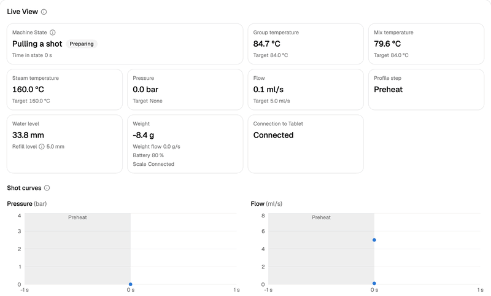
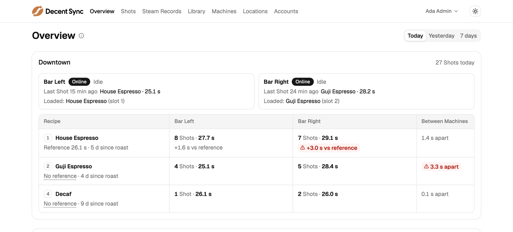
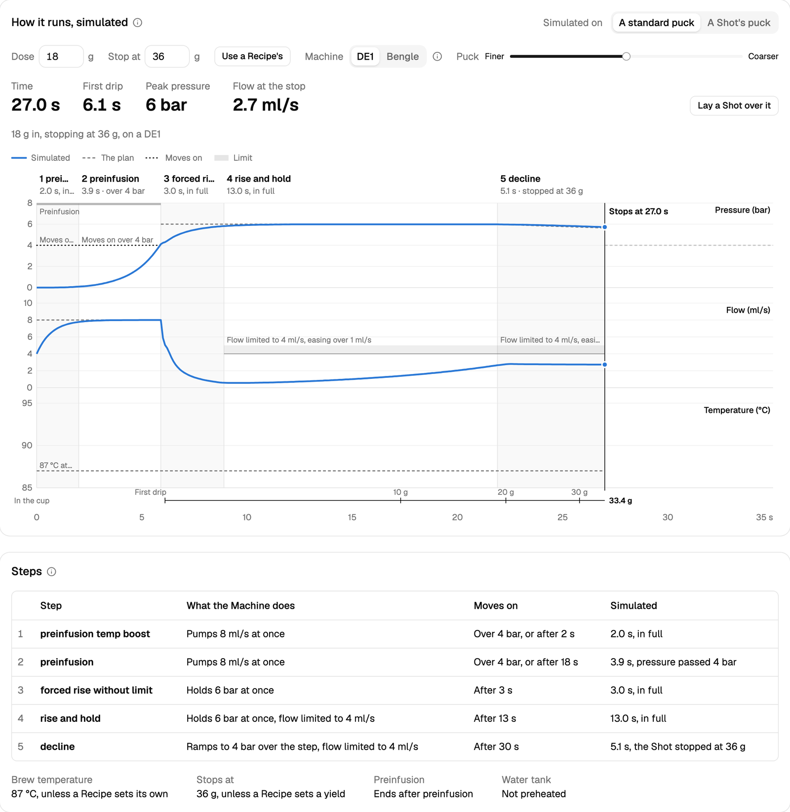

<h1>
  <picture>
    <source media="(prefers-color-scheme: dark)" srcset="web/src/assets/decent-sync-logo-dark.svg">
    
  </picture>
</h1>

**Your Decent espresso machines, working as one.**

Decent Sync connects every Decent espresso machine you run, at home or across
several cafes, to one server you host yourself. Enter a bag of beans once and
every machine has it. Dial in on one machine, and the others with that recipe
follow. Every shot from every machine lands in one place, linked to the beans,
grinder and profile that made it.

It works with any DE1 model or a Bengle running
[Decaid](https://github.com/decentespresso/decaid). It is free and open
source, and it runs in production at its author's cafe.

**[Documentation](https://loganfuller.github.io/decent-sync/) · [Quick start](#quick-start) · [Releases](https://github.com/loganfuller/decent-sync/releases)**

<p align="center">
  <picture>
    <source media="(prefers-color-scheme: dark)" srcset="docs/images/live-view-dark.gif">
    
  </picture>
  <br>
  <sub>A shot on a Machine's Live View, at twice its speed. Screenshots use sample data, but every curve is a real recorded shot.</sub>
</p>

## What you get

- **One Library.** Beans, batches, grinders and profiles entered on any tablet
  reach every machine at that Location.
  [Library and Recipes](https://loganfuller.github.io/decent-sync/guide/library-and-recipes/)
- **Recipes that follow the dial-in.** A change made on one machine reaches
  every machine with that Recipe loaded.
  [How a dial-in change travels](https://loganfuller.github.io/decent-sync/guide/library-and-recipes/#how-a-dial-in-change-travels)
- **Every shot, traceable.** Each shot is kept with its curves and linked to
  its bean batch, grinder, profile and recipe.
  [Shots](https://loganfuller.github.io/decent-sync/guide/shots/)
- **Drift you can see.** Give a Recipe a Reference Shot, and shots that run
  long, short or off their yield are marked out of spec.
  [What out of spec means](https://loganfuller.github.io/decent-sync/guide/shots/#what-out-of-spec-means)
- **Profiles on a graph.** Read how a profile runs, edit it by dragging its
  steps, and try a draft on a machine before publishing it.
  [Profiles and Drafts](https://loganfuller.github.io/decent-sync/guide/profiles-and-drafts/)
- **Machines from anywhere.** Watch a shot live, change settings and manage a
  tablet's plugins and skins from your phone.
  [Machines](https://loganfuller.github.io/decent-sync/guide/machines/)
- **Ask about your coffee.** Connect Claude, ChatGPT or another MCP app and
  ask in plain words.
  [Assistants](https://loganfuller.github.io/decent-sync/guide/assistants/)
- **Yours to run.** One Docker image and PostgreSQL. Machines keep working
  when the server is down, and catch up after.
  [Self-hosting](https://loganfuller.github.io/decent-sync/self-hosting/docker-compose/)

<picture>
  <source media="(prefers-color-scheme: dark)" srcset="docs/images/overview-dark.png">
  
</picture>

<p>
  <picture>
    <source media="(prefers-color-scheme: dark)" srcset="docs/images/shot-dark.png">
    
  </picture>
  <picture>
    <source media="(prefers-color-scheme: dark)" srcset="docs/images/profile-dark.png">
    
  </picture>
</p>

## Who it's for

Each server has one owner: a household, or a business with all of its sites.

- **A home with two machines.** One bean shelf, shared. A bag entered on
  either tablet appears on both, and every shot from both machines is in one
  history.
- **A cafe.** Several DE1s work like the groups of one commercial machine: the
  same Recipes on the same buttons, and a dial-in change on one reaching every
  one with that Recipe loaded.
- **A roastery with cafes.** Develop Profiles and Recipes in the lab, roll
  them out to each cafe, and trace every shot back to its roast batch. Each
  person gets the access they need: Admin, Staff or Viewer.

## How it works

```
Tablets (Decaid + plugin) ── WebSocket ──┐
Management interface ─────── REST API ───┼──▶  Server  ──▶  PostgreSQL
AI assistants ────────────── MCP ────────┘
```

The plugin runs inside Decaid on each machine's tablet. It sends the server
everything the tablet records, and writes the shared Library and Recipes back
to it. Baristas keep using Decaid, DYE2 and Streamline exactly as before.

- **A Machine is its hardware.** Replacing its tablet doesn't make it a new
  Machine.
- **Machines are adopted by hand.** An Admin adds each one, which issues a
  token for its plugin.
- **The server is the source of truth, but tablets can still edit.** A tablet
  holds only what its Location offers, and what it creates starts there.

More in [Architecture](https://loganfuller.github.io/decent-sync/technical/architecture/).

## Quick start

You need Docker on a computer your machines' tablets can reach, at a fixed
address on your network, and Decaid v0.9.3 or newer on each tablet.

1. Download the Compose file, set the address people and tablets will use,
   and start the server:

   ```bash
   curl -O https://raw.githubusercontent.com/loganfuller/decent-sync/main/docker-compose.yml
   echo 'PUBLIC_URL=http://192.168.1.20:3000' > .env
   docker compose up -d
   ```

2. Open `PUBLIC_URL` in a browser and create the first Admin account. Do this
   straight away: until you do, anyone who can reach the server can.
3. Under **Locations**, add one for each site.
4. Under **Machines**, add each machine at its Location, and copy the server
   URL and token it shows. The token is shown only once.
5. On each tablet, in Decaid's **Settings**, then **Plugins**,
   [install](https://loganfuller.github.io/decent-sync/get-started/install-the-plugin/)
   `loganfuller/decent-sync` from a GitHub release, enter the server URL and
   token in its settings, and load it.

Over plain `http://`, traffic is unencrypted, each Machine's token included.
Use it only on a network you trust. The
[self-hosting guide](https://loganfuller.github.io/decent-sync/self-hosting/docker-compose/)
covers running on the internet, fly.io and every setting.

> [!IMPORTANT]
> Tablets install each new plugin release within 12 hours, unless it asks
> for a new permission.
> [Upgrade the server](https://loganfuller.github.io/decent-sync/self-hosting/upgrading/)
> soon after each release: `docker compose pull && docker compose up -d`.

## Documentation

| Read | For |
|---|---|
| [Get started](https://loganfuller.github.io/decent-sync/get-started/what-decent-sync-is/) | Your first Location, Machine and plugin, and inviting people |
| [Guide](https://loganfuller.github.io/decent-sync/guide/library-and-recipes/) | The Library and Recipes, Profiles and Drafts, Shots, Machines, assistants, accounts |
| [Self-hosting](https://loganfuller.github.io/decent-sync/self-hosting/docker-compose/) | Configuration, local networks and the internet, fly.io, upgrading |
| [The tablet plugin](https://loganfuller.github.io/decent-sync/reference/tablet-plugin/) | Updating it, and what it does on the tablet |
| [Upgrade notes](https://loganfuller.github.io/decent-sync/reference/upgrade-notes/) | What each release needs beyond its new image |
| [Glossary](https://loganfuller.github.io/decent-sync/reference/glossary/) | What each term means |

## For developers

- [Architecture](https://loganfuller.github.io/decent-sync/technical/architecture/):
  what syncs where, the protocol in outline, and the design decisions.
- [Internals](https://loganfuller.github.io/decent-sync/technical/internals/):
  the behaviour specs, and every ADR.
- [Assistant tool reference](https://loganfuller.github.io/decent-sync/reference/assistant-tools/):
  each MCP tool an assistant can call.
- [For a Skin's author](https://loganfuller.github.io/decent-sync/technical/skin-authors/):
  what the plugin answers a Skin on its tablet.
- [Development](https://loganfuller.github.io/decent-sync/technical/development/):
  building, testing and releasing, from
  [docs/DEVELOPMENT.md](docs/DEVELOPMENT.md). Node.js 26 and Docker.

## Status

In production at its author's cafe. See
[the releases](https://loganfuller.github.io/decent-sync/project/releases/) for
what each added, and the
[roadmap](https://loganfuller.github.io/decent-sync/project/roadmap/) for what
is planned: monitoring and alerts, calibration checks, and moving a Bean Batch
between Locations.

## License

[MIT](LICENSE)
